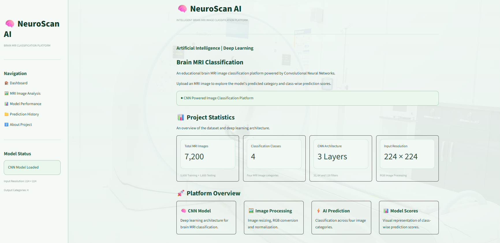

# 🧠 NeuroScan AI
### Brain Tumor Detection and Classification Using Convolutional Neural Networks

An AI-powered brain MRI image classification application developed using **Python, TensorFlow, Keras, CNN, and Streamlit**.

NeuroScan AI is a deep learning project that classifies brain MRI images into four categories through an interactive web application.

---

## 🌐 Application Preview



*NeuroScan AI – Professional Brain MRI Classification Dashboard*

---

## 🚀 Project Overview

Brain tumor classification using MRI images is an important application of medical image analysis.

This project demonstrates how Convolutional Neural Networks (CNNs) can extract image features and classify brain MRI scans into four categories.

The Streamlit application allows users to:
- Upload brain MRI images.
- Preview uploaded images.
- Generate predictions using a trained CNN model.
- View predicted categories.
- Explore class-wise prediction scores.
- Download prediction reports.
- View prediction history.

## 🎯 Project Objectives

- Develop a CNN-based image classification model.
- Perform image preprocessing and normalization.
- Classify brain MRI images into four categories.
- Build an interactive web application using Streamlit.
- Explore the application of deep learning in medical image analysis.

---

## 📊 Dataset Information

**Dataset:** Brain Tumor MRI Dataset

**Source:** Kaggle

**Dataset Link:** https://www.kaggle.com/datasets/masoudnickparvar/brain-tumor-mri-dataset

| Dataset | Number of Images |
|---|---:|
| Training | 5,600 |
| Testing | 1,600 |
| **Total** | **7,200** |

### Classification Categories

1. Glioma
2. Meningioma
3. No Tumor
4. Pituitary

---

## 🧠 CNN Model Architecture

The project uses a Convolutional Neural Network to learn image features and perform multiclass classification.

### Architecture

| Layer | Configuration |
|---|---|
| Input Layer | 224 × 224 × 3 |
| Conv2D | 32 Filters, 3 × 3 |
| Batch Normalization | Applied |
| MaxPooling2D | 2 × 2 |
| Conv2D | 64 Filters, 3 × 3 |
| Batch Normalization | Applied |
| MaxPooling2D | 2 × 2 |
| Conv2D | 128 Filters, 3 × 3 |
| Batch Normalization | Applied |
| MaxPooling2D | 2 × 2 |
| Flatten | Feature Flattening |
| Dense | 64 Neurons, ReLU |
| Dropout | 0.1 |
| Output Layer | 4 Neurons, Softmax |

### Model Configuration

- Framework: TensorFlow / Keras
- Optimizer: Adam
- Loss Function: Sparse Categorical Crossentropy
- Evaluation Metric: Accuracy
- Image Size: 224 × 224
- Batch Size: 32
- Training Epochs: 5
- Normalization: Pixel values scaled between 0 and 1

---

## ✨ Application Features

- Professional healthcare-inspired interface.
- Brain MRI image upload.
- Uploaded image preview.
- Image preprocessing.
- CNN-based image classification.
- Four-category prediction.
- Prediction score display.
- Class-wise prediction visualization.
- Downloadable prediction report.
- Prediction history.
- Project information section.

---

## 🛠️ Technologies Used

| Technology | Purpose |
|---|---|
| Python | Programming Language |
| TensorFlow | Deep Learning Framework |
| Keras | CNN Model Development |
| NumPy | Numerical Operations |
| Pandas | Data Handling |
| Matplotlib | Data Visualization |
| Pillow | Image Processing |
| Streamlit | Web Application |
| Scikit-learn | Machine Learning Utilities |

---

## 📁 Project Structure

```text
Brain-Tumor-Detection-CNN/
│
├── app.py
├── main.py
├── requirements.txt
├── README.md
├── .gitignore
│
├── brain_tumor_model.keras
│
└── screenshots/
    └── neuroscan-ai-dashboard.png
```

---

## 💻 Installation and Setup

### 1. Clone the Repository

```bash
git clone https://github.com/gauravkatre55/Brain-Tumor-Detection-CNN.git
```

### 2. Navigate to the Project Folder

```bash
cd Brain-Tumor-Detection-CNN
```

### 3. Install Dependencies

```bash
pip install -r requirements.txt
```

### 4. Run the Streamlit Application

```bash
streamlit run app.py
```

### 5. Open the Application

Open the local URL displayed in your terminal.

Usually:

```text
http://localhost:8501
```

---

## 🔮 Future Improvements

- Improve model generalization and classification performance.
- Experiment with transfer learning architectures such as VGG16 and ResNet50.
- Implement data augmentation.
- Add Grad-CAM for visual model explainability.
- Improve image preprocessing.
- Deploy the application online.

---

## 👨‍💻 Developer

**Gaurav Katre**

Machine Learning & Deep Learning Enthusiast

- GitHub: https://github.com/gauravkatre55
- LinkedIn: https://www.linkedin.com/in/gauravkatre/

---

## ⚠️ Disclaimer

This project is developed strictly for educational and research purposes.

The model is not clinically validated and must not be used for medical diagnosis or treatment decisions. Its predictions are experimental and should not replace evaluation by qualified medical professionals.

---

⭐ If you find this project interesting, consider giving the repository a star!
